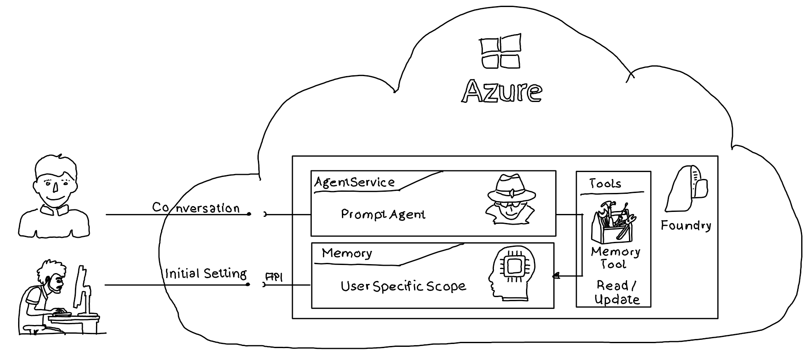

# Microsoft Foundry Memory

## Overview

Microsoft Foundry is Microsoft's unified platform for building, deploying, and managing AI applications and agents on Azure. It brings together AI models, development tools, and services for connecting enterprise data, evaluating AI behavior, and monitoring applications, with built-in security and governance.

Foundry Memory gives AI agents persistent context across conversations by storing and retrieving relevant information from past interactions. It helps agents remember user preferences and important details, enabling more personalized and consistent responses.

## Repo Content

### Intro

This repository demonstrates two ways to interact with Foundry Memory: 



  - Directly through the API and through the Foundry Memory Tool. The API sample sets user communication preferences, simulating pre-loading preferences from existing stores. 

  - The tool-based sample uses a declarative memory tool supported Foundry agent across three simulated conversations: 
    - First, the agent retrieves and reports the initially configured contact method; 
    - Second, the user changes their preferred contact method to private e-mail;
    - Third, the agent retrieves the updated preference from the memory store.


### Demo Apps

#### Create & Initialize Memory Store

The [set_memory sample](./src/set_memory/Program.cs) connects a configured Foundry project and creates a memory store.

```csharp
MemoryStoreDefaultDefinition memoryStoreDefaultDefinition = new MemoryStoreDefaultDefinition(
    chatModel: chatModelDeploymentName,
    embeddingModel: embeddingModelDeploymentName
);

memoryStoreDefaultDefinition.Options = new MemoryStoreDefaultOptions(
    isUserProfileEnabled: true,
    isChatSummaryEnabled: true
);

MemoryStore memoryStore = aiProjectClient.MemoryStores.CreateMemoryStore(
    name: memoryStoreName,
    definition: memoryStoreDefaultDefinition,
    description: "Memory store demo"
);
```

It writes initial communication preferences into a user-specific scope, including SMS as the preferred contact method. A second update adds Telegram availability. 

```csharp
MemoryUpdateOptions memoryUpdateOptions = new MemoryUpdateOptions(memoryScope)
{
    UpdateDelay = 0, // Trigger update immediately without waiting for inactivity
};

string userInformation = @"
    User preferes being contacted via SMS. 
    If SMS is not available Multifactor Authentication (Microsoft Authenticator) can be used.
";

memoryUpdateOptions.Items.Add(ResponseItem.CreateUserMessageItem(userInformation));

MemoryUpdateResult updateResult =
    aiProjectClient.MemoryStores.WaitForMemoriesUpdate(
        memoryStoreName: memoryStore.Name,
        options: memoryUpdateOptions,
        pollingInterval: 50);
```

The second update adds Telegram availability in the same user-specific scope. `PreviousUpdateId` links it to the initial update.

```csharp
memoryUpdateOptions = new MemoryUpdateOptions(memoryScope)
{
    PreviousUpdateId = updateResult.UpdateId,
    UpdateDelay = 0, // Trigger update immediately without waiting for inactivity
};

userInformation = @"
    I'm now also available on telegram.
";
memoryUpdateOptions.Items.Add(ResponseItem.CreateUserMessageItem(userInformation));

MemoryUpdateResult memoryUpdateResult =
    aiProjectClient.MemoryStores.WaitForMemoriesUpdate(
        memoryStoreName: memoryStore.Name,
        options: memoryUpdateOptions,
        pollingInterval: 50);

if (memoryUpdateResult.Status == MemoryStoreUpdateStatus.Failed)
{
    throw new InvalidOperationException(memoryUpdateResult.ErrorDetails);
}
```

#### Use Memory with a Prompt Agent

The [agent_using_memory sample](./src/agent_using_memory/Program.cs) creates a prompt agent with a memory search tool connected to the existing memory store and user-specific scope. It demonstrates retrieving the initial contact preference, changing it to private e-mail, and retrieving the updated preference in a later request.

```csharp
string agentName = "projectOptimizer";

MemorySearchPreviewTool memorySearchTool = new MemorySearchPreviewTool(memoryStoreName, memoryScope);
memorySearchTool.UpdateDelayInSecs = 1;

string agentInstructions = @"
    You are a helpful assistant that helps optimizing processes. 
    If necessary you use tools to identify communication preferences.
";

DeclarativeAgentDefinition declarativeAgentDefintion = new DeclarativeAgentDefinition(chatModelDeploymentName) {
    Instructions = agentInstructions,
    Tools = { memorySearchTool }
};

ProjectsAgentVersionCreationOptions projectsAgentVersionCreationOptions = new ProjectsAgentVersionCreationOptions(declarativeAgentDefintion);
ProjectsAgentVersion projectsAgentVersion =
    aiProjectClient.AgentAdministrationClient.CreateAgentVersion(agentName, projectsAgentVersionCreationOptions);
```

The first request asks the agent how it would contact the user. The expected preference is SMS, as previously stored by the initialization sample.

```csharp
ProjectResponsesClient responseClient = aiProjectClient
    .ProjectOpenAIClient
    .GetProjectResponsesClientForAgent(projectsAgentVersion.Name);

string prompt = @"
    Send me the phrase 'I like it'. 
    Show me how you will contact me.
    Don't provide any further information.
";
ResponseItem responseItem = ResponseItem.CreateUserMessageItem(prompt);
ResponseResult responseResult = responseClient.CreateResponse([responseItem]);
Console.WriteLine($"Expected contact method: SMS (as provided via memory store)");
Console.WriteLine($"\t{responseResult.GetOutputText().Replace("\n", "").Replace("\r", "")}");
```

The next request changes the preference to private e-mail. The sample explicitly updates the memory store through the API and waits for completion before asking the agent to respond.

```csharp
prompt = @"
  Send me again 'I like it'.
  From now on preferred contact method is private e-mail.
";
responseItem = ResponseItem.CreateUserMessageItem(prompt);

MemoryUpdateOptions memoryUpdateOptions = new MemoryUpdateOptions(memoryScope) {
    UpdateDelay = 0
};
memoryUpdateOptions.Items.Add(responseItem);
aiProjectClient.MemoryStores.WaitForMemoriesUpdate(memoryStoreName, 500, memoryUpdateOptions);

responseResult = responseClient.CreateResponse([responseItem]);
Console.WriteLine($"Expected contact method: private e-mail");
Console.WriteLine($"\t{responseResult.GetOutputText().Replace("\n", "").Replace("\r", "")}");
```

The final request does not repeat the preference. The agent can retrieve it from memory, with private e-mail as the expected contact method.

```csharp
prompt = @"
  Send me again 'I like it'.
  Provide the contact method.
";
responseItem = ResponseItem.CreateUserMessageItem(prompt);
responseResult = responseClient.CreateResponse([responseItem]);
Console.WriteLine($"Expected contact method: private e-mail");
Console.WriteLine($"\t{responseResult.GetOutputText().Replace("\n", "").Replace("\r", "")}");
```

### Repro Structure

| Link | Folder | Description |
| --- | --- | --- |
| [application config](./config) | config | Environment configuration and template for the samples. |
| [setup Foundry / Azure environment](./setup) | setup | Bicep template and Azure CLI script for provisioning Foundry resources. |
| [prompt agent sample](./src/agent_using_memory) | agent_using_memory | Agent sample that retrieves and updates communication preferences using Foundry Memory. |
| [set memory API](./src/set_memory) | set_memory | API sample that creates a memory store, writes preferences, and searches memories. |
